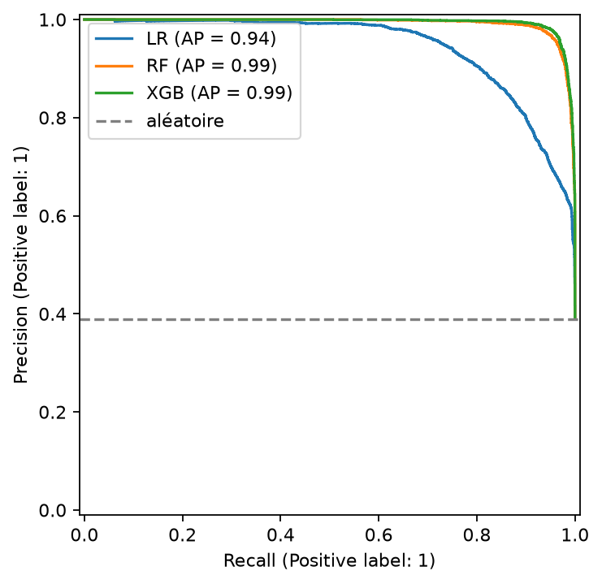
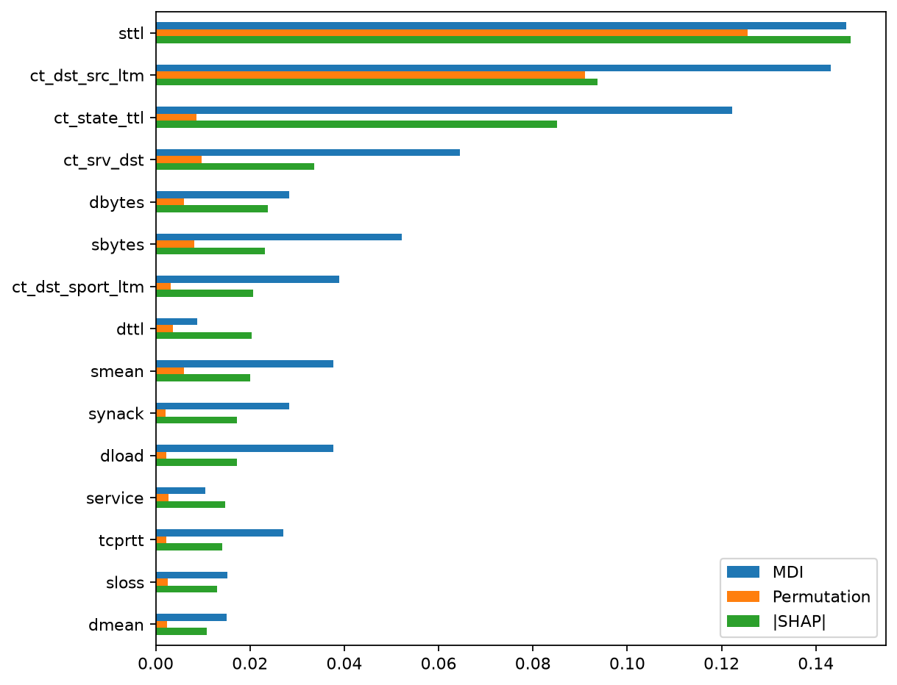
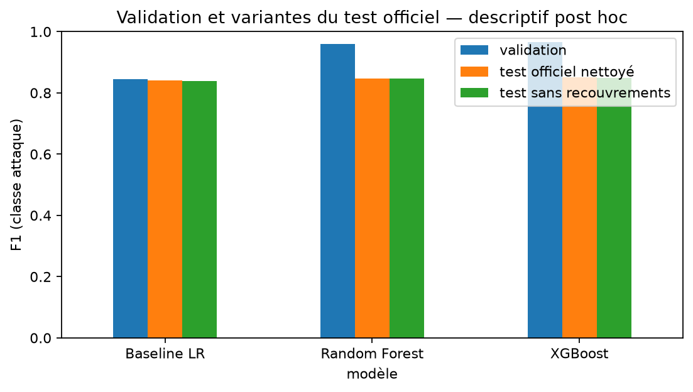

# Interprétabilité d'un détecteur d'intrusion — UNSW-NB15

Projet de machine learning appliqué à la cybersécurité : comparaison d'une régression logistique, d'une Random Forest et de XGBoost, puis analyse des variables avec MDI, permutation et SHAP.

Question centrale : le modèle identifie-t-il des comportements d'attaque ou des particularités du jeu de données et de sa collecte ?

## Résultats

Après nettoyage, le train et la validation contiennent chacun 38,9 % d'attaques, contre 51,8 % pour le test officiel nettoyé avec ses recouvrements; cette proportion est de 51,4 % après leur retrait. Les modèles sont ajustés sur le train; les comparaisons, explications et ablations sont faites sur la validation. Les encodeurs d'arbres font partie du pipeline de recherche d'hyperparamètres : ils sont donc ajustés séparément dans chaque fold de validation croisée. Le test est réservé au compte rendu final.

| Modèle | Partition | PR-AUC | ROC-AUC | F1 attaque |
|---|---|---:|---:|---:|
| Régression logistique | Validation | 0.9446 | 0.9589 | 0.8453 |
| Random Forest | Validation | 0.9924 | 0.9946 | 0.9590 |
| XGBoost | Validation | 0.9941 | 0.9958 | 0.9653 |
| Régression logistique | Test officiel nettoyé, recouvrements conservés | 0.9568 | 0.9581 | 0.8401 |
| Random Forest | Test officiel nettoyé, recouvrements conservés | 0.9764 | 0.9751 | 0.8470 |
| XGBoost | Test officiel nettoyé, recouvrements conservés | 0.9758 | 0.9753 | 0.8505 |
| Régression logistique | Test sans recouvrements train/test | 0.9562 | 0.9582 | 0.8387 |
| Random Forest | Test sans recouvrements train/test | 0.9761 | 0.9754 | 0.8461 |
| XGBoost | Test sans recouvrements train/test | 0.9755 | 0.9755 | 0.8496 |

Pour XGBoost, le rappel de la classe attaque passe de 0.963 en validation à environ 0.754 sur le test officiel nettoyé, tandis que la précision reste proche (0.967 puis 0.974). L'écart de F1 est donc principalement associé à une baisse du rappel. La différence de prévalence et le décalage des variables/familles d'attaque sont des explications possibles, pas une preuve de causalité. Le diagnostic descriptif du notebook intervient après l'évaluation finale et ne sert pas à retoucher le modèle.

### Décalage train/test

Après nettoyage, la prévalence des attaques est de 38,9 % dans le train et la validation, contre 51,8 % dans le test officiel nettoyé (51,4 % après retrait des recouvrements). La composition des familles change également : `Fuzzers` passe de 8,6 % du train à 15,0 % du test officiel, et `Exploits` de 13,7 % à 18,4 %; la part `Normal` baisse de 61,1 % à 48,2 %.

Parmi les dix variables les plus importantes selon SHAP sur la validation, ces décalages univariés train/test sont observés :

| Variable | KS D | Médiane train | Médiane test |
|---|---:|---:|---:|
| `dbytes` | 0.077 | 354 | 354 |
| `ct_srv_dst` | 0.072 | 3 | 3 |
| `ct_state_ttl` | 0.069 | 1 | 1 |
| `sttl` | 0.066 | 254 | 62 |
| `ct_dst_src_ltm` | 0.062 | 2 | 2 |

KS D compare les distributions complètes, pas seulement les médianes; ces écarts descriptifs ne démontrent pas à eux seuls la cause de la baisse de rappel.

### Sensibilité aux doublons entre partitions

Après nettoyage interne (valeurs manquantes/non finies et doublons dans chaque partition), le test officiel contient 107 740 flux. Parmi eux, 1 722 (1,6 %) ont les mêmes caractéristiques qu'un flux du train. Le notebook présente les scores une fois sur tous les flux du test officiel nettoyé, puis sur les 106 018 flux restants après leur retrait. Les F1 changent peu : XGBoost 0.8505 contre 0.8496, Random Forest 0.8470 contre 0.8461 et régression logistique 0.8401 contre 0.8387. La version sans recouvrements est la mesure de sensibilité; le score sur le test officiel nettoyé permet de voir l'effet de cette décision méthodologique.

### Ablation sur validation

En retirant `sttl` et `ct_state_ttl`, le F1 Random Forest passe de 0.9590 à 0.9583 et la PR-AUC de 0.9924 à 0.9919. La faible baisse observée suggère que le modèle RF conserve presque les mêmes performances de validation sans ces variables; elle ne prouve pas une généralisation hors de ce jeu.

### Stabilité SHAP

Trois Random Forest sont entraînées sur des sous-échantillons stratifiés différents (80 % du sous-ensemble d'entraînement). Les trois utilisent le même `X_val` indépendant pour l'explication; le Jaccard moyen des ensembles top-10 est de 1.00.

### Figures

Courbes précision-rappel calculées sur la validation :



Importances RF calculées sur la validation :



Comparaison du F1 validation/test pour le compte rendu post hoc :



Les images sont produites par les cellules du notebook. Exécuter le notebook de haut en bas pour les régénérer.

## Données

Télécharger la partition officielle UNSW-NB15 et placer ces deux fichiers dans `data/` :

- `UNSW_NB15_training-set.csv`
- `UNSW_NB15_testing-set.csv`

Les CSV ne sont pas inclus dans Git. Voir [data/README.md](data/README.md) pour les consignes. Le notebook supprime les identifiants, valeurs non finies/manquantes et doublons internes; il écarte aussi du test les doublons exacts de caractéristiques présents dans le train, sans consulter leurs étiquettes.

## Installation et exécution

Windows PowerShell, Python 3.12 recommandé :

```powershell
cd C:\projet-ml-ids
py -3.12 -m venv .venv
.\.venv\Scripts\Activate.ps1
python -m pip install -r requirements.txt
jupyter lab
```

Ouvrir JupyterLab depuis l'URL affichée dans le terminal, puis ouvrir `projet1_unsw_nb15_interpretabilite.ipynb`. Exécuter les cellules dans l'ordre. La dernière section est l'évaluation unique sur le test officiel; ne pas modifier le modèle à partir de ses résultats.

## Reproductibilité et limites

- Graine fixée à 42 pour les découpages, les modèles et les échantillons.
- L'encodeur et les modèles sont ajustés sur le train seulement.
- Les explorations, importances, exemples SHAP et l'ablation utilisent la validation.
- Le découpage est non temporel; le test a une proportion d'attaques différente après nettoyage.
- SHAP porte sur un échantillon de validation; les variables corrélées peuvent se partager l'importance.
- Un seul jeu est étudié : les performances ne garantissent pas la généralisation à du trafic réel.

## Références

1. N. Moustafa et J. Slay (2015). “UNSW-NB15: a comprehensive data set for network intrusion detection systems (UNSW-NB15 network data set).” *MilCIS*, 1–6. [doi:10.1109/MilCIS.2015.7348942](https://doi.org/10.1109/MilCIS.2015.7348942).
2. N. Moustafa et J. Slay (2016). “The evaluation of Network Anomaly Detection Systems: Statistical analysis of the UNSW-NB15 data set and the comparison with the KDD99 data set.” *Information Security Journal: A Global Perspective*, 25(1–3), 18–31. [doi:10.1080/19393555.2015.1125974](https://doi.org/10.1080/19393555.2015.1125974).
3. M. Ring et al. (2019). “A survey of network-based intrusion detection data sets.” *Computers & Security*, 86, 147–167. [doi:10.1016/j.cose.2019.06.005](https://doi.org/10.1016/j.cose.2019.06.005).

## Auteur

Ranim-jb — [profil GitHub](https://github.com/Ranim-jb).

## Métadonnées suggérées pour GitHub

- **Description** : Interprétabilité d'un détecteur d'intrusion sur UNSW-NB15 avec Random Forest, XGBoost, SHAP et analyse du décalage train/test.
- **Topics** : `cybersecurity`, `intrusion-detection`, `machine-learning`, `unsw-nb15`, `explainable-ai`, `shap`, `jupyter-notebook`
